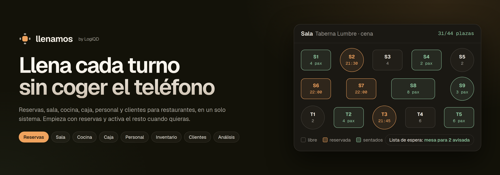
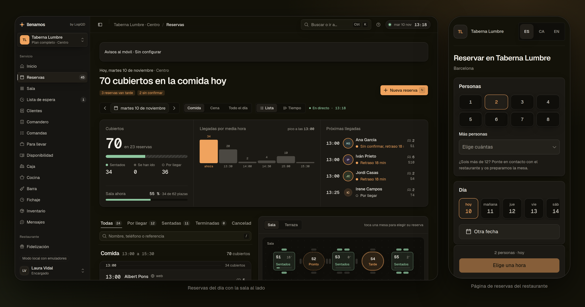
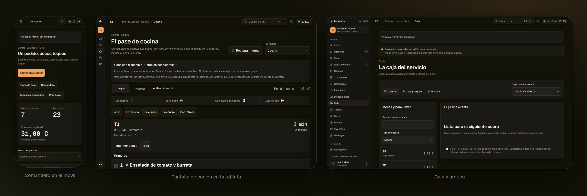
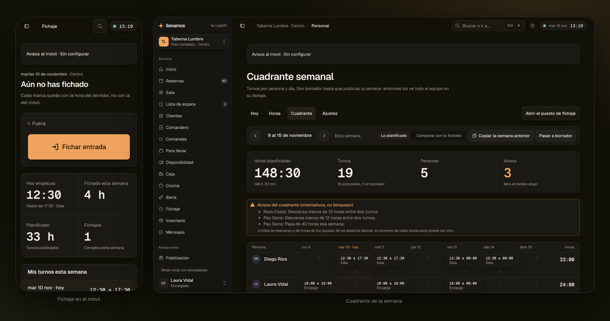
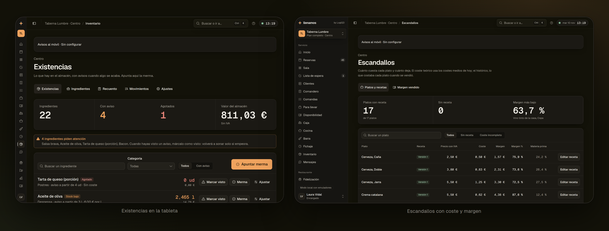
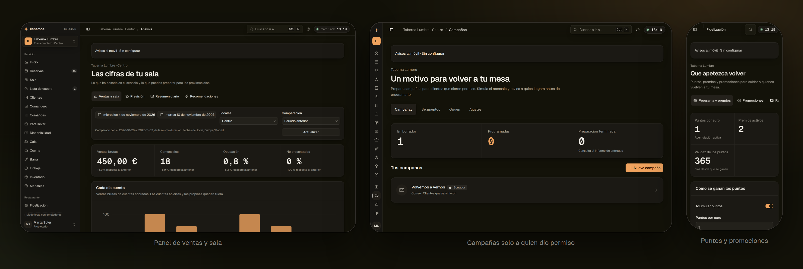
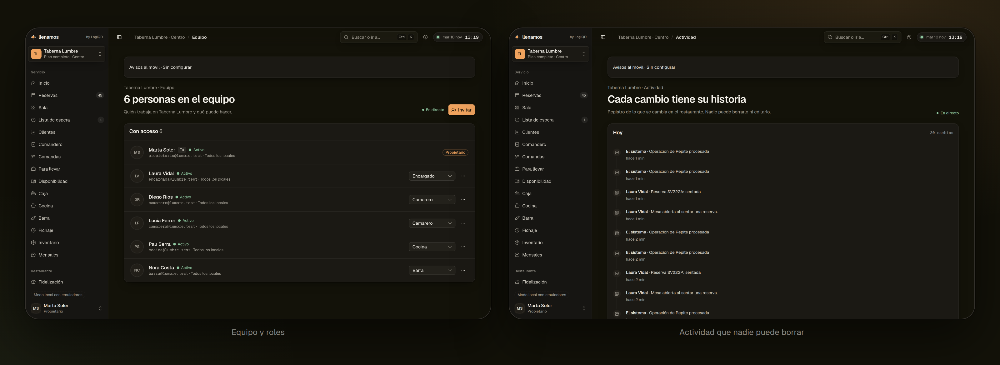
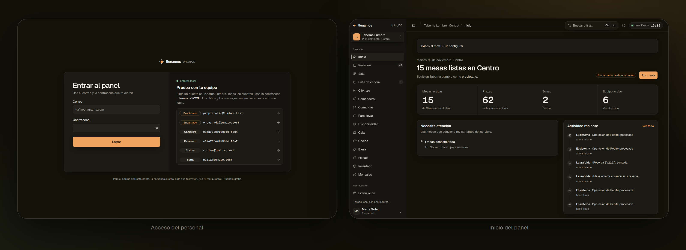

<p align="center">
  
</p>

<p align="center">
  
  
  
  
  
  
</p>

<p align="center">
  <a href="docs/ESTADO.md"><b>Estado de cada fase</b></a> ·
  <a href="docs/tareas/TRASPASO.md"><b>Traspaso</b></a> ·
  <a href="PLAN.md"><b>Plan por fases</b></a> ·
  <a href="ARQUITECTURA.md"><b>Contrato del sistema</b></a> ·
  <a href="docs/tareas">Repartos por fase</a> ·
  <a href="apps/web/AGENTS.md">Notas para agentes</a>
</p>

**Llenamos** es el sistema para restaurantes de [LogiQD](https://logiqd.me): reservas, plano de sala,
cocina, caja, carta, clientes, personal y análisis en un solo programa. Lo que lo distingue de un TPV
cualquiera son las **reservas que de verdad llenan mesas**: señal contra los no presentados,
confirmación por WhatsApp, lista de espera que avisa sola y petición de reseña al día siguiente. Se
vende por planes: un restaurante puede empezar solo con reservas y activar sala, cocina, caja o la
tarjeta de sellos de [Repite](https://logiqd.me/repite) más adelante, sin cambiar de programa.

> [!NOTE]
> Las fases 0 a 6 están **hechas y probadas de punta a punta**. Todo funciona **solo en local**, con los emuladores de Firebase y el proyecto
> `demo-llenamos`: no hay nada desplegado ni cuentas reales (Stripe, WhatsApp, Verifactu y Repite van
> con dobles de prueba que lo dicen en pantalla). El restaurante de demostración,
> **Taberna Lumbre**, es inventado. La cabecera es una ilustración del producto; las capturas del
> panel son reales, contra los emuladores.

<details>
<summary><b>Índice</b></summary>

- [La idea](#-la-idea)
- [Hoja de ruta](#%EF%B8%8F-hoja-de-ruta)
- [El panel del personal](#-el-panel-del-personal)
- [Cómo está hecho](#-cómo-está-hecho)
- [Desarrollo en local](#-desarrollo-en-local)
- [Pruebas](#-pruebas)
- [Seguridad y permisos](#%EF%B8%8F-seguridad-y-permisos)
- [Estructura](#%EF%B8%8F-estructura)
- [Cómo se trabaja](#-cómo-se-trabaja)

</details>

## 🍽️ La idea

Digital cuando ayuda, humano siempre disponible: la carta en papel, el camarero tomando nota y el
efectivo siguen funcionando igual. Llenamos se inspira en lo que hace RestaurantOS, pero **se escribe
desde cero**: se aprovechan sus lecciones, no su código.

- **Dinero en céntimos enteros**, nunca decimales.
- **Los precios se recalculan en el servidor**: lo que manda el móvil del cliente no se cree.
- **Cada restaurante solo ve lo suyo**, comprobado en el código y otra vez en la base de datos.
- **Los avisos salen de la misma operación que los provoca**, para no avisar de cosas que no han
  pasado.
- **Una tarea tiene dueño**: dos camareros no pueden coger el mismo plato.
- **Nada se simula en silencio**: si falta Stripe o el correo, la interfaz lo dice.

## 🗺️ Hoja de ruta

Cada fase termina con algo que se puede enseñar y vender, y no se pasa a la siguiente sin las
pruebas en verde. El detalle está en [PLAN.md](PLAN.md).

| Fase | Qué trae | Estado |
| --- | --- | --- |
| **0 · Cimientos** | Monorepo, CI, modelo multi restaurante, acceso del personal, roles, reglas de acceso, sistema de diseño y registro de actividad | 🟢 hecha |
| **1 · Llenamos Reservas** | Editor del plano, horarios y turnos, página de reservas con la marca del restaurante y widget, WhatsApp y correo, señal con tarjeta, lista de espera, mesa sugerida, ficha de cliente, importar desde Excel y reseñas | 🟢 hecha |
| **2 · Sala y cocina** | Carta digital con alérgenos, comandero, pedido por QR, pantallas de cocina y barra, tareas con dueño, para llevar | 🟢 hecha |
| **3 · Caja y tickets legales** | Cobros, dividir la cuenta, arqueo, Verifactu (con proveedor de prueba), impresora térmica, pago desde el móvil y propinas | 🟢 hecha |
| **4 · Personal, inventario y costes** | Fichaje en móvil y tableta, cuadrante, propinas por horas, existencias que bajan solas al vender, merma, recuento, escandallos y pedidos a proveedores | 🟢 hecha |
| **5 · Clientes, marketing y análisis** | Puntos y promociones, tarjeta de sellos con [Repite](https://logiqd.me/repite) en el Wallet, campañas solo a quien dio permiso, origen de cada reserva, panel de ventas, resumen diario, previsión y automatizaciones que recomiendan | 🟢 hecha |
| **6 · Plataforma** | Funcionar sin internet, alta por su cuenta, planes con Stripe Billing y suspensión por impago, panel de LogiQD, API y webhooks, copias cifradas y RGPD | 🟢 hecha |
| **Lanzamiento** | Producción, `llenamos.logiqd.me` y sustituir a Restaurant OS en logiqd.me | ⚪ cuando lo decida el propietario |

**Fuera de alcance, de momento:** reparto a domicilio propio, apps nativas en las tiendas (la PWA
cubre el arranque) y Reserve with Google como socio oficial.

## 🧑‍🍳 El panel del personal

<p align="center">
  
</p>

En `/panel`, para el equipo del restaurante. Cada persona ve lo que le toca según su rol y los
módulos del plan, y si trabaja en varios restaurantes elige cuál al entrar.

- **Servicio**: inicio, reservas (lista, vista por horas y vista partida con el plano), sala en
  directo, lista de espera, clientes, comandero, comandas, para llevar, disponibilidad, caja, cocina,
  barra, fichaje, inventario y mensajes.
- **Restaurante**: carta, sala y cocina, impresoras, personal y cuadrante, escandallos, compras,
  plano, horarios, compartir, equipo, actividad, importar, plan y facturación, integraciones,
  privacidad y ajustes.
- **Clientes y números**: fidelización, campañas y análisis.
- **Ctrl K** abre la paleta de órdenes para ir a cualquier sitio.

**Servicio.** El camarero toma nota en el móvil, cocina ve los pases en la tableta y la caja cobra,
divide y cierra el turno.

<p align="center">
  
</p>

**Personal y costes.** Cada uno ficha desde su móvil, el encargado prepara el cuadrante y el
almacén baja solo al vender, con el coste y el margen de cada plato.

<p align="center">
  
</p>

<p align="center">
  
</p>

**Clientes y números.** Panel de ventas con comparativas, campañas solo a quien dio permiso y
puntos y promociones validados en el servidor.

<p align="center">
  
</p>

<p align="center">
  
</p>

| Rol | Qué puede hacer |
| --- | --- |
| **Propietario** | Todo, incluido gestionar a otros propietarios, contratar el plan y lanzar campañas |
| **Encargado** | Todo menos tocar a los propietarios y el plan: equipo, ajustes, costes, compras, cuadrante, análisis y campañas en borrador |
| **Camarero** | Sala, reservas, clientes, comandero, caja, fichaje y su cuadrante; canjea puntos y aplica promociones |
| **Cocina** | Su pantalla de cocina, existencias y merma sin ver costes, fichaje y su cuadrante |
| **Barra** | Su pantalla de barra, existencias y merma sin ver costes, fichaje y su cuadrante |

<p align="center">
  
</p>

Un restaurante nunca se queda sin propietario activo y nadie puede cambiarse el rol a sí mismo. Cada
rol solo puede dar roles iguales o inferiores al suyo.

## 🧱 Cómo está hecho

| Pieza | Qué es | Con qué |
| --- | --- | --- |
| [`apps/web`](apps/web) | Web pública de reservas y panel del personal | Next.js 16.4 (App Router, Turbopack, `cacheComponents`) · React 19 · Tailwind 4 · SDK web de Firebase |
| [`functions`](functions) | Todo lo que escribe o cobra: callables, disparadores y procesos programados, una carpeta por fase (`fase2` a `fase6-*`) | Cloud Functions for Firebase (región `europe-west1`), empaquetadas con tsup |
| [`packages/core`](packages/core) | Lógica compartida sin Firebase: dinero, roles, módulos y planes, esquemas de cada función y la lógica pura de reservas, sala, caja, personal, inventario, fidelización, marketing y análisis | TypeScript + zod |
| [`firebase`](firebase) | Reglas de Firestore y Storage, índices | — |
| [`tests/rules`](tests/rules) | Pruebas de las reglas contra el emulador | Vitest + `@firebase/rules-unit-testing` |
| [`scripts`](scripts) | Seeds del restaurante de demostración, trabajadores locales y recorridos en navegador | tsx + firebase-admin + Playwright |
| [`tools/print-bridge`](tools/print-bridge) | Puente local para imprimir tickets ESC/POS desde la tableta | Node |

**Diseño:** el mismo aspecto que la web de venta. Modo oscuro cálido (fondo `#131209`), acento ámbar
`#f0a35e`, verde `#8fc7a0` para «sentados» y «correcto», tipografía Geist (Geist Mono para las
cifras) e iconos de Phosphor. Interfaz en castellano.

**Datos:** Firestore, con un árbol por restaurante: `restaurants/{rid}` → `members`, `locations` →
`areas` y `tables`, y `activity`. El índice de cada persona (`users/{uid}.restaurants`) solo lo
escriben las funciones. El esquema completo está en [ARQUITECTURA.md](ARQUITECTURA.md#datos-en-firestore).

## 💻 Desarrollo en local

**Requisitos:** Node.js 22 o superior, pnpm 12 y Java 21 (lo necesita el emulador de Firestore). No
hace falta cuenta de Firebase: el prefijo `demo-` del proyecto hace que los emuladores funcionen sin
tocar nada real.

```bash
pnpm install
cp apps/web/.env.example apps/web/.env.local
pnpm funciones:build          # compila functions/lib
pnpm emuladores               # Auth, Firestore, Functions y Storage
pnpm seed                     # Taberna Lumbre (con los emuladores en marcha)
pnpm seed:servicio            # carta, mesas abiertas y comandas de un servicio
pnpm seed:caja                # caja (fase 3)
pnpm exec tsx scripts/seed-fase4.ts   # personal, existencias, recetas y proveedores
pnpm exec tsx scripts/seed-fase5.ts   # programa de puntos, promociones, campañas e historia para la previsión
pnpm web                      # http://localhost:3000
```

Los datos de los emuladores se guardan en `.emuladores/` al cerrarlos y se cargan al volver a
arrancar. El seed se puede ejecutar las veces que haga falta: no duplica nada.

<details>
<summary><b>Puertos</b></summary>

<br>

| Servicio | Puerto |
| --- | --- |
| Web | 3000 |
| Web de venta | 5181 |
| Interfaz de los emuladores | 4001 |
| Auth | 9099 |
| Firestore | 8085 |
| Functions | 5001 |
| Storage | 9199 |

</details>

### Cuentas de demostración

Todas con la contraseña **`Llenamos2026!`**. En local, la pantalla de acceso (`/entrar`) las lista
para entrar con un clic.

| Correo | Rol |
| --- | --- |
| `propietario@lumbre.test` | Propietario |
| `encargada@lumbre.test` | Encargado |
| `camarero@lumbre.test` · `camarera@lumbre.test` | Camarero |
| `cocina@lumbre.test` | Cocina |
| `barra@lumbre.test` | Barra |

### Scripts

| Comando | Qué hace |
| --- | --- |
| `pnpm web` | Web en modo desarrollo |
| `pnpm landing` | Web de venta en modo desarrollo (http://localhost:5181) |
| `pnpm emuladores` | Emuladores de Firebase con los datos de `.emuladores/` |
| `pnpm seed` · `pnpm seed:servicio` · `pnpm seed:caja` | Cargan el restaurante de demostración y un servicio en marcha |
| `pnpm impresion:puente` | Puente local de la impresora de tickets |
| `pnpm mensajes:procesar` · `pnpm sala:procesar` · `pnpm pago:procesar` | Trabajadores locales (mensajes, recogidas, pago móvil) que en producción son procesos programados |
| `pnpm funciones:build` | Compila las funciones |
| `pnpm lint` · `pnpm typecheck` · `pnpm test` | En todos los paquetes |
| `pnpm test:reglas` | Pruebas de las reglas contra el emulador de Firestore |
| `pnpm build` | Compila todo |
| `pnpm verificar` | Todo lo anterior seguido, como la CI |

## ✅ Pruebas

| Dónde | Qué cubre | Comando |
| --- | --- | --- |
| `packages/core` | Unas 600 pruebas de la lógica pura: dinero, roles y módulos, reservas, sala, caja, horas y pausas, costes y existencias, puntos, promociones, campañas, métricas y previsión | `pnpm --filter @llenamos/core test` |
| `functions` | Permisos y casos límite de cada función; con emuladores, integración de punta a punta de cada fase (doble cobro, carreras, reintentos, disparadores reales) | `pnpm --filter functions test` |
| `tests/rules` | Unas 150 pruebas de las reglas, a favor y en contra: sin sesión, miembro inactivo, otro restaurante, cada rol, módulo apagado, campos y tipos | `pnpm test:reglas` |
| `apps/web` | Unas 650 pruebas de lógica y componentes de las pantallas | `pnpm --filter web test` |
| `scripts/*-navegador.ts` | Recorridos reales en el navegador con capturas, en [`docs/diseno/capturas/`](docs/diseno/capturas) | `pnpm exec tsx scripts/fase4-navegador.ts` |

Las pruebas de integración se activan con `TEST_FIREBASE_EMULATORS=1` y los emuladores en marcha; las
de disparadores necesitan también el emulador de funciones (`TEST_FIREBASE_TRIGGERS=1`).

La CI de GitHub ejecuta `pnpm verificar` con Node 22 y Java 21 en cada push y cada pull request.

## 🛡️ Seguridad y permisos

- **Tres comprobaciones que dicen lo mismo:** la interfaz oculta lo que no toca, las funciones lo
  vuelven a comprobar y las reglas de Firestore lo comprueban otra vez. La tabla de permisos vive en
  [`packages/core/src/roles.ts`](packages/core/src/roles.ts) y hay pruebas que vigilan que las reglas
  coincidan.
- **Acceso por local:** cada miembro puede tener una lista de locales; vacía significa todos.
- **Lo delicado solo en el servidor:** altas, cambios de rol, bajas y el índice de restaurantes de
  cada persona se escriben desde funciones, en una transacción. Desde el navegador solo se editan el
  plano y los ajustes, y con validación de campos y tipos.
- **Actividad que no se borra:** la escriben las funciones; nadie puede editarla ni borrarla desde la
  web.
- **Errores claros:** las funciones responden con códigos estándar y un mensaje en castellano que se
  puede enseñar tal cual.

## 🗂️ Estructura

```
apps/web/                 web pública, reserva, carta por QR y panel del personal (Next.js 16.4)
apps/landing/             web de venta de Llenamos (Vite, puerto 5181)
functions/src/            funciones: reservas y mensajes en la raíz, una carpeta por fase (fase2 … fase6-*)
packages/core/src/        lógica compartida y esquemas de cada función, una carpeta por área
firebase/                 reglas de Firestore y Storage, índices
tests/rules/              pruebas de las reglas contra el emulador
scripts/                  seeds, trabajadores locales y recorridos en navegador
tools/print-bridge/       puente local de la impresora de tickets
docs/ESTADO.md            qué trae cada fase y cómo va
docs/tareas/              repartos por fase, encargos de los agentes y traspaso
docs/diseno/              sistema de diseño y capturas reales de cada pantalla
docs/integraciones/       lo que Llenamos espera de otros sistemas (Repite)
docs/operacion/           copias, privacidad y cómo operar la plataforma
docs/readme/              imágenes de este README
ARQUITECTURA.md           contrato entre las piezas
PLAN.md                   plan por fases, decisiones y registro de avances
```

## 🤝 Cómo se trabaja

- [ARQUITECTURA.md](ARQUITECTURA.md) es el **contrato**: si algo cambia, se actualiza en el mismo
  commit.
- Next.js 16.4 es más nuevo de lo que conocen muchos modelos: antes de tocar la web, se leen las
  guías de `apps/web/node_modules/next/dist/docs/` (ver [apps/web/AGENTS.md](apps/web/AGENTS.md)).
- TypeScript estricto, sin `any` sin justificar, comentarios y textos en castellano.
- No se añaden dependencias sin necesidad.
- Cada parte se entrega con su `typecheck`, `lint` y `test` en verde.

<br>

<p align="center">
  <br>
  <sub><i>Que no se quede ni una mesa vacía.</i></sub><br>
  <sub>Hecho por <a href="https://logiqd.me">LogiQD</a></sub>
</p>
