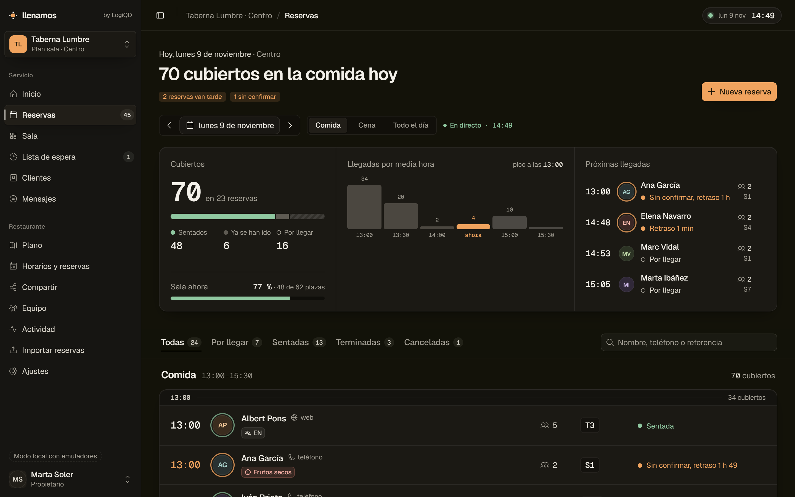

# Propuesta B · Sala cálida

## La idea en cinco líneas

1. Que se note que es para un restaurante: el plano de la sala manda, con cada mesa dibujada con su forma y sus sillas según plazas.
2. Cada mesa dice su estado con color, icono y palabra, el nombre de quien está y los minutos que llevan; al pulsarla se abre su ficha al lado con la acción que toca (terminar, sentar, confirmar).
3. Las reservas son filas ricas, no una tabla: hora grande en Geist Mono, avatar con iniciales, alergia, habitual, cumpleaños, idioma, origen y visitas, agrupadas por media hora.
4. La cabecera del servicio es una sola pieza con tres zonas (cubiertos y su reparto, ritmo de llegadas con «ahora» en ámbar, próximas llegadas), no cuatro tarjetas iguales.
5. Tema oscuro tostado con capas escalonadas y sombras suaves; movimiento corto y solo donde informa (la ficha entra, la mesa elegida se levanta).

| Pantalla | Captura |
|---|---|
| Reservas del día, 1440×900 | [`reservas.png`](reservas.png) |
| Sala en directo, 1440×900 | [`sala.png`](sala.png) |
| Ficha de una mesa abierta al lado del plano | [`detalle.png`](detalle.png) |
| Reservas en el móvil, 390×844 | [`movil.png`](movil.png) |

Todas son capturas reales de la aplicación con los emuladores y `pnpm seed` + `pnpm seed:servicio` (propietario de Taberna Lumbre), a 2x.

## Qué se ha tocado

| Pieza | Archivo |
|---|---|
| Tema: superficies, sombras y la clase `superficie` | `apps/web/src/app/globals.css` |
| Armazón: cabecera con el reloj del servicio, ancho completo en sala y reservas | `components/panel/PanelShell.tsx` |
| Barra lateral: activo en capa alzada, cifras en píldora, selector de restaurante en bloque | `components/panel/sidebar/*` |
| Control segmentado (turno, zona) con la opción elegida alzada | `components/common/segmented-control.tsx` |
| Reservas: título, avisos, resumen del turno, filtros fijos, filas por media hora | `app/(personal)/panel/reservas/ReservasView.tsx`, `components/reservas/ResumenTurno.tsx` |
| Avatar, etiquetas ricas y origen del cliente | `components/reservas/Huesped.tsx` |
| Detalle de la reserva (panel lateral): avatar, etiquetas, cifras grandes | `components/reservas/ReservationDetail.tsx` |
| Plano con mesas, sillas, estados, encuadre automático | `components/sala/Plano.tsx` |
| Ficha de la mesa | `components/sala/FichaMesa.tsx` |
| Sala: pulso de la sala, plano, ficha, llegadas y mesas plegadas | `app/(personal)/panel/sala/SalaView.tsx` |

No se ha tocado la lógica: ni `functions/`, ni `packages/core/`, ni reglas, ni `apps/web/src/lib/**`. Las acciones siguen siendo las mismas (`actionsFor` y `runStatusAction`); la ficha de la mesa solo lanza desde allí la acción principal cuando no pide nada más, y el resto abre el detalle de siempre.

## Componentes y de dónde salen

| Pieza | Origen | Licencia |
|---|---|---|
| `ui/progress` (ocupación de la sala, tiempo de la mesa) | Registro `@shadcn/progress`, estilo radix-nova | MIT, shadcn |
| `ui/scroll-area` (lista de llegadas) | Registro `@shadcn/scroll-area` | MIT, shadcn |
| `ui/collapsible` (mesas de la zona, plegadas bajo el plano) | `@shadcn/collapsible` (ya estaba) | MIT, shadcn |
| `ui/avatar` (iniciales del cliente con aro de estado) | `@shadcn/avatar` (ya estaba) | MIT, shadcn |
| `ui/tabs` en variante `line` (filtros por estado con contador) | `@shadcn/tabs` (ya estaba) | MIT, shadcn |
| `ui/sheet`, `ui/dropdown-menu`, `ui/toggle-group`, `ui/sidebar` | `@shadcn` (ya estaban), bloque `sidebar-07` y `site-header` de `dashboard-01` | MIT, shadcn |
| Etiquetas con icono y aro interior | Patrón de los badges de estado de Origin UI (`comp-420` a `comp-422`, coss.com/origin, github.com/cosscom/ui), adaptado sin copiar código | MIT, coss.com |
| Entrada de la ficha de la mesa | `motion` (motion.dev), ya era dependencia | MIT |
| Iconos de estado y etiquetas | Phosphor (`@phosphor-icons/react`), ya era dependencia | MIT |

**Dependencias nuevas**: ninguna en `package.json`. `progress` y `scroll-area` usan `radix-ui`, que ya estaba. Se probó `@shadcn/hover-card` y se quitó porque no aportaba.

## Reglas del diseño anterior que cambian y por qué

1. **«Bordes finos en vez de sombras»** pasa a **borde fino y sombra suave**. Con solo bordes, todo quedaba al mismo nivel y el panel parecía una plantilla. Ahora hay capas: fondo `#131209`, plano hundido `#0f0e0a`, bloque `#1b1914`, capa alzada `#211e18`, flotante `#24211b`, con una sombra corta y cálida (`--sombra-suave`, `--sombra-flotante`). Siguen sin haber degradados, brillos ni cristal.
2. **Superficie `#181818` gris** pasa a **`#1b1914` tostado**. El gris neutro se peleaba con el fondo cálido de la marca.
3. **«Listas y tablas antes que tarjetas»** se mantiene a medias: sigue siendo una fila por reserva, pero sin rejilla de tabla con cabeceras. Las filas van dentro de una superficie por turno y con un separador por media hora que dice los cubiertos de esa franja. Se lee como el libro de reservas, no como una hoja de cálculo.
4. **«El estado con punto y palabra»** se amplía en el plano a **color, icono y palabra**: un punto de 8 px no se ve a un metro de la pantalla en mitad del servicio. En las listas sigue el punto y la palabra.
5. **Tamaños**: titular de 26 a 32 px en escritorio (24 en el móvil), horas de las filas a 17–18 px en Geist Mono, cifras del resumen a 48 px. Radios de 14 px en las superficies grandes (antes 10).
6. **Ancho**: sala y reservas usan hasta 1600 px; el resto de páginas sigue en 1152 px.

Se mantiene: un solo botón ámbar por pantalla (en la sala lo trae la ficha de la mesa), el ámbar solo para la acción principal y «ahora», verde para sentados, rojo cálido para alergias, castellano llano sin guiones dentro de las frases ni mayúsculas en cada palabra, foco visible, 44 px en pantallas táctiles y movimiento con `cubic-bezier(0.32, 0.72, 0, 1)`.
